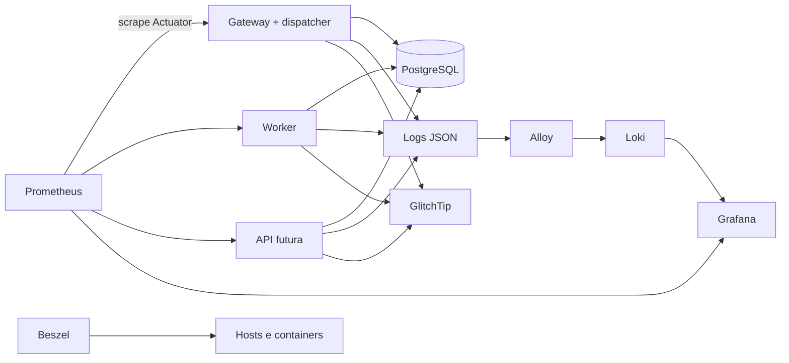

# Aporia Tracking Service — Observabilidade

Plano de implementação e contrato operacional. Estado: planejamento aprovado; implementação e validação ainda pendentes. O checkout atual, as migrations e os testes são a fonte de verdade. Este documento complementa `AGENTS.md` e não certifica prontidão para produção.

## 1. Decisões

- Java 25, Maven, Spring Boot, Spring Web MVC (futura API), Actuator e Micrometer. Escolher uma versão estável e suportada do Boot compatível com Java 25, após verificar o POM e a matriz oficial. Usar BOM; não fixar versões transitivas arbitrariamente.
- Não criar `MetricsHttpServer` nem outro servidor HTTP artesanal. Actuator será a interface de gerenciamento de todos os processos Java.
- Preservar JDBC, HikariCP, PostgreSQL 16/PostGIS, Flyway e núcleo multiprotocolo. Spring gerencia configuração, dependências e lifecycle; domínio não depende de Spring quando desnecessário.
- Proposta de implantação: um artefato, perfis `gateway`, `worker`, `api`, processos independentes; dispatcher junto ao gateway proprietário das sessões. Confirmar entrypoints existentes antes de alterar. Não iniciar listeners ou polling duplicados.
- Prometheus para métricas, Grafana para dashboards e alertas, Loki para logs, Grafana Alloy para coleta de logs, GlitchTip para exceções, Beszel para hosts/containers. Docker Compose versionado. Reutilizar serviços centrais existentes quando possível.
- Entregas incrementais definitivas, sem implementações descartáveis. Não declarar produção pronta sem critérios de aceitação.

## 2. Topologia e segurança



Portas propostas e configuráveis: management gateway 9101, worker 9102, API 9103; API pública 8080 atrás de proxy; TCP conforme configuração existente; Prometheus 9090, Grafana 3000, Loki 3100. Em containers separados pode-se reutilizar a mesma porta interna. Não publicar management, Loki ou Prometheus na internet. Rede privada Docker/WireGuard, firewall e autenticação/TLS quando cruzar hosts. Grafana com acesso autenticado, sem cadastro anônimo, RBAC e credenciais fora do Git. Não expor env, heapdump, configprops, shutdown ou endpoints de diagnóstico sensíveis. Health público, se necessário, sem detalhes internos.

## 3. Catálogo de métricas

Nomes abaixo são contratos propostos no formato exportado pelo Prometheus; Micrometer usa nomes pontuados e acrescenta sufixos de unidade/tipo. Testar nomes efetivamente expostos. Labels permitidos: `protocol`, `outcome`, `reason` (enum limitado), `stage`, `role`, `environment`; `job` e `instance` vêm da coleta. Nunca usar IMEI, tenant_id, device_id, packet_id, command_id, IP, payload ou mensagem de exceção como labels. Evitar duplicar métricas nativas de JVM, Hikari e HTTP.

| Métrica | Tipo | Semântica |
|---|---|---|
| tracking_devices_connected | Gauge | Sessões registradas válidas por gateway; não confundir com dispositivos únicos entre réplicas |
| tracking_tcp_connections_active | Gauge | Sockets aceitos ainda abertos, inclusive não identificados |
| tracking_tcp_connections_total | Counter | Conexões aceitas |
| tracking_tcp_disconnections_total | Counter | Encerramentos por motivo limitado |
| tracking_tcp_rejections_total | Counter | Rejeições por motivo limitado |
| tracking_tcp_bytes_received_total | Counter | Bytes lidos, inclusive frames inválidos |
| tracking_packets_received_total | Counter | Frames completos recebidos |
| tracking_packets_ingested_total | Counter | Pacotes persistidos após commit |
| tracking_packets_processed_total | Counter | Processamento confirmado após commit |
| tracking_packets_failed_total | Counter | Falhas por categoria, definir tentativa versus terminal |
| tracking_packet_processing_seconds | Timer/histogram | Duração de processamento, inclusive resultado categorizado |
| tracking_packet_queue_depth | Gauge | Pendências persistidas por estado |
| tracking_packet_queue_oldest_age_seconds | Gauge | Idade da pendência mais antiga; zero se fila vazia |
| tracking_commands_enqueued_total | Counter | Comandos criados após commit |
| tracking_command_dispatch_total | Counter | Resultado da tentativa, sem confundir escrita e execução |
| tracking_commands_responded_total | Counter | Respostas correlacionadas após commit |
| tracking_command_queue_depth | Gauge | Quantidade por estado persistido |
| tracking_command_response_seconds | Timer/histogram | Latência de resposta correlacionada |
| tracking_command_write_seconds | Timer/histogram | Duração da escrita local TCP |
| tracking_queue_sample_success | Gauge | 1 se última amostragem bem-sucedida, 0 se falhou |
| tracking_queue_sample_timestamp_seconds | Gauge | Instante da última amostragem válida |

Métricas de banco: coletor periódico com timeout, índices e consulta agregada, sem query por scrape ou por dispositivo. Publicar snapshot thread-safe; não transformar falha de consulta em zero. Um coletor lógico por banco, ou deduplicação explícita na consulta Grafana; não somar a mesma fila em várias réplicas. Contadores de eventos só após commit quando representarem persistência; não prometer contagem exata de negócio em caso de crash. Histórico individual e contabilidade exata permanecem no PostgreSQL.

Histogramas com buckets/SLOs explícitos após medir distribuição; evitar percentis locais agregados. Medir latência e fila separadamente. Gauge de sessões deve observar o registro real, não incrementar/decrementar cegamente em reconexões. Monitorar CPU, memória, GC, threads, virtual threads quando suportado, pool JDBC, HTTP e uptime com binders nativos.

## 4. Roadmap e critérios de aceite

### Fase 1 — Integração Spring Boot
- [ ] Auditar `pom.xml`, entrypoints, configuração, datasource, Flyway e lifecycle existentes.
- [ ] Selecionar versão suportada, adicionar starters web, actuator e registry Prometheus; configurar plugin Boot e testes conforme necessidade.
- [ ] Migrar bootstrap para beans/configuração tipada validada; perfis sem duplicação de tarefas. Um proprietário de migrations por implantação; não executar Flyway automaticamente em todo processo sem política explícita.
- [ ] Encerramento ordenado: parar novas conexões/polling, finalizar ou interromper operações com prazo, fechar sessões e pool por último.
- [ ] Expor apenas health/prometheus; readiness/liveness com semânticas distintas. Liveness não depende do banco; readiness reflete dependências necessárias ao papel.
- Aceite: build, unitários e ITs passam; processo inicia e termina sem vazamentos; endpoint scrape válido e inacessível externamente.

### Fase 2 — Instrumentação do núcleo
- [ ] Instrumentar gateway, worker, dispatcher, respostas e recuperação nos pontos reais de transição; preservar contratos e transações.
- [ ] Implementar snapshots de filas e idade, instrumentar JVM/Hikari/HTTP; evitar duplicação de binders.
- [ ] Testar contadores, gauges, reconexões, rollback, falhas, concorrência, ausência de labels de alta cardinalidade.
- Aceite: carga simulada gera métricas coerentes; rollback não contabiliza sucesso; scrape não bloqueia processamento; falha de amostragem é visível.

### Fase 3 — Infraestrutura Prometheus/Grafana
- [ ] Compose com versões fixadas, volumes persistentes, healthchecks, limites de recursos, redes privadas e segredos externos.
- [ ] Scrape por papel/instância, intervalo inicial 15s, timeout inferior ao intervalo; retenção inicial 30 dias, limite de disco dimensionado e revisado por carga.
- [ ] Provisionar datasources, dashboards e alertas versionados; configurar canal de notificação e testar entrega.
- Aceite: targets UP, histórico persiste após restart, dashboards funcionam sem configuração manual, acesso restrito.

### Fase 4 — Logs, exceções e hosts
- [ ] Logs JSON com timestamp UTC, nível, serviço, ambiente, versão e correlation_id; IDs operacionais apenas quando necessários e com controle de acesso. Não registrar credenciais, payloads brutos ou localização por padrão.
- [ ] Alloy coleta logs dos containers e envia ao Loki; labels de baixa cardinalidade, IDs como campos JSON. Restringir acesso ao Docker socket; preferir coleta com privilégios mínimos.
- [ ] Loki com retenção explícita (proposta 14 dias), limites e armazenamento persistente; validar descarte e recuperação.
- [ ] Integrar SDK compatível com GlitchTip, DSN externo, release/environment, filtragem de dados sensíveis e deduplicação de eventos; capturar falhas não tratadas e falhas críticas tratadas seletivamente.
- [ ] Beszel para CPU, RAM, disco, rede e containers; reutilizar instalação existente se disponível.
- Aceite: erro simulado aparece em logs e GlitchTip, correlação pesquisável, nenhum segredo em eventos, métricas de host disponíveis.

### Fase 5 — Operação e validação
- [ ] Dashboards: visão geral, gateway, worker, comandos, JVM/JDBC, infraestrutura, API quando disponível.
- [ ] Alertas iniciais: target indisponível, fila envelhecida, crescimento de erros, entrega incerta, saturação JDBC, disco, amostragem desatualizada. Ajustar limites após baseline e SLOs; evitar alertar por ausência legítima de tráfego.
- [ ] Teste de carga com simuladores TCP, reconexões, mensagens inválidas, falha de banco, falha de scrape e reinicialização. Medir throughput, p95/p99, CPU, memória e cardinalidade.
- [ ] Runbooks, backup/restore de configurações e dados necessários, política de retenção, atualização/rollback e teste de notificação. Monitorar a própria stack.
- Aceite: teste de carga e falhas documentado, alertas acionados e resolvidos, recuperação verificada, custos e capacidade medidos. Não expor comandos sensíveis até validar segurança do dispatcher e correlação.

## 5. Consultas e painéis

Exemplos PromQL (validar nomes após instrumentação):

```promql
sum(tracking_devices_connected)
sum(increase(tracking_tcp_connections_total[1h]))
sum(increase(tracking_packets_ingested_total[1h]))
sum(rate(tracking_packets_processed_total[5m]))
histogram_quantile(0.95, sum by (le) (rate(tracking_packet_processing_seconds_bucket[5m])))
max(tracking_packet_queue_oldest_age_seconds)
```

Conectados por hora: média/máximo de gauge em janelas de uma hora; conexões por hora: increase do counter. Dispositivos únicos que conectaram na hora exigem histórico de eventos ou agregação no banco, não contagem de conexões. Para réplicas, soma de sessões só representa dispositivos únicos se houver propriedade exclusiva comprovada. Contadores Prometheus são estimativas operacionais, não faturamento.

## 6. Estrutura proposta

```
src/main/java/software/aporia/tracking/
  config/          # configuração Spring e lifecycle
  observability/   # instrumentação e snapshots
  gateway/
  worker/
  command/
  storage/
  api/             # futura API
src/main/resources/
  application.yml
  application-gateway.yml
  application-worker.yml
  application-api.yml
infra/observability/
  compose.yml
  prometheus/
  grafana/provisioning/
  grafana/dashboards/
  loki/
  alloy/
docs/runbooks/
README-OBSERVABILITY.md
```

Adaptar à estrutura real; não criar classes vazias ou duplicar configurações. Não criar migrations para métricas sem necessidade demonstrada.

## 7. Validação e regras de trabalho

```bash
mvn clean test -Dtest='*Test,*IT'
```

Executar ITs exclusivamente no banco `aporia_tracking_test`, contêiner `aporia-tracking-postgis-test`, usando `TRACKING_TEST_DB_URL`, `TRACKING_TEST_DB_USER`, `TRACKING_TEST_DB_PASSWORD`. Nunca alterar dev/produção ou outros containers. Não publicar valores de segredos. Verificar `.envrc` antes de autorizar direnv.

Ao finalizar cada fase: registrar arquivos alterados, testes executados, evidências, decisões e bloqueios; atualizar checkboxes somente com evidência. Não confundir testes verdes com prontidão operacional. A API REST de negócio vem após a observabilidade, sem impedir a criação da infraestrutura Spring agora.

## 8. Próxima ação

Revisar POM, árvore de fontes, entrypoints gateway/worker, classe Database, configuração de ambiente, Compose e AGENTS.md atual. Definir versão Boot compatível e plano de lifecycle antes de editar. O repositório não foi auditado nesta revisão; nomes, portas, retenções e topologia são propostas a confirmar, não fatos sobre a implantação existente.
