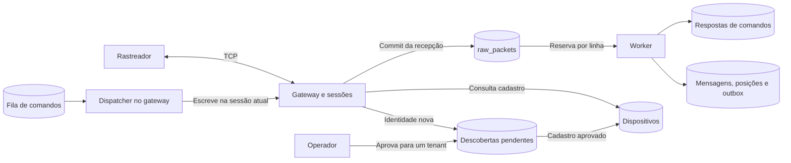

# Arquitetura e fluxos de execução

O gateway é dono das conexões TCP. O worker é dono do processamento da fila de pacotes brutos. O PostgreSQL guarda a passagem de uma etapa para a outra: o gateway pode confirmar a recepção antes de o worker calcular uma posição. O dispatcher opcional compartilha a JVM do gateway para alcançar as sessões em memória. A API HTTP está prevista para uma etapa posterior.

## Conexão e descoberta

1. O listener aceita o socket. O primeiro byte seleciona um adaptador candidato no modo `auto`. O adaptador cria uma sessão de protocolo para aquela conexão. Seu buffer conserva fragmentos e pode emitir vários quadros a partir da mesma leitura TCP.
2. O gateway consulta o par protocolo e identidade declarada. Para um Suntech desconhecido, valida o conteúdo ASCII. No Teltonika, responde ao login para obter o primeiro lote AVL e valida estrutura, codec e CRC antes da descoberta. O IMEI permite reconhecer reconexões. A marca compatível vem do formato observado.
3. Uma identidade nova fica em `device_discoveries`. O operador consulta a view de pendências e aprova para um tenant. Antes da aprovação, essa conexão termina após a descoberta. A próxima conexão do equipamento habilitado abre uma sessão de dispositivo.
4. O registro de sessões usa tenant e dispositivo como chave. Uma reconexão invalida a sessão anterior. A remoção compara a instância para que o encerramento tardio de um socket antigo preserve a conexão mais recente.
5. Para cada quadro de dados, a ingestão revalida o cadastro e grava bytes, hash e versão do decodificador. Para AVL, o ACK do lote informa o número de registros **após o commit**. Nesse instante os bytes já estão no banco e o processamento das posições ainda pode estar pendente. [Guia de cadastro e protocolos](gateway-tcp.md)

## Threads, conexões e limites

| Quem executa | Trabalho e consequência |
| --- | --- |
| Thread principal do gateway | Aceita conexões no `ServerSocket` com backlog solicitado de 50. Esse número diz respeito à espera por aceite. Cada socket aceito segue para uma tarefa própria. |
| Thread virtual por conexão | Lê o socket, alimenta o adaptador e faz a ingestão JDBC. O prazo inicial é de 30 s e a inatividade de uma sessão identificada tem padrão de 180 s. O socket pode permanecer aberto por várias mensagens. |
| Agendador do dispatcher | Quando habilitado, executa uma rodada de recuperação e percorre as sessões. Aguarda 1 s **após** a rodada para iniciar a próxima. Uma escrita lenta pode atrasar outros dispositivos nessa varredura. |
| Agendador de prazo de escrita | Compartilhado pelas sessões na JVM. Se a escrita exceder 5 s, fecha o socket para desbloquear a operação. A escrita e a invalidação usam o mesmo bloqueio por sessão. |
| Laço principal do worker | Processa até um pacote por chamada, repete imediatamente após trabalho e dorme 1 s quando a fila está vazia. Após erro no laço, espera 3 s antes de continuar. |
| Pool JDBC por JVM | Cada processo mantém seu HikariCP com máximo de 10 conexões, mínimo ocioso de 2 e espera de até 10 s por uma conexão. Com um gateway e um worker, reserve capacidade para até 20 conexões da aplicação, além das administrativas. Uma sessão TCP ociosa não exige uma conexão JDBC exclusiva. |

Ao encerrar, o gateway interrompe o aceite e fecha sockets para liberar as leituras. O worker sinaliza a parada e permite a conclusão do ciclo corrente. Os hooks aguardam até 10 s, e o Compose concede 15 s antes do encerramento forçado. As sessões vivem na memória da instância; um gateway recém-iniciado volta a enxergar cada equipamento quando ele reconecta. [Gateway](../src/main/java/software/aporia/tracking/gateway/TcpGateway.java) · [Sessão TCP](../src/main/java/software/aporia/tracking/gateway/DeviceSession.java) · [Pool JDBC](../src/main/java/software/aporia/tracking/storage/Database.java)

## Do pacote à posição

Cada worker considera apenas as versões presentes no seu registro de decodificadores. Um pacote incompatível permanece pendente, com seus bytes e tentativas preservados, até que uma instância compatível o processe. O worker seleciona uma linha `pending` com `available_at` vencido. O PostgreSQL usa `FOR UPDATE OF rp SKIP LOCKED` para que consumidores concorrentes possam avançar sobre linhas diferentes. O worker verifica o SHA-256, localiza a versão do decodificador gravada na ingestão e compara a identidade interpretada com o cadastro.

O `TrackingWorker` decide validação, decodificação e política de retentativa. O `PacketProcessingRepository`, em `storage.packet`, reserva o pacote, mantém a conexão e coordena os repositórios existentes na mesma transação; SQL, savepoint, commit e rollback ficam nessa camada. O resultado só retorna ao worker após o commit, antes de qualquer log de conclusão.

Uma transação cobre a mensagem processada, as posições, a atualização de última posição, os eventos de outbox, as respostas aplicáveis e o estado do pacote. Para cada leitura com horário, coordenadas e fix válido, `assignments` resolve o ativo pela vigência **no horário da leitura**. Uma posição atrasada entra no histórico e só avança `last_positions` se for mais recente. O PostGIS recebe longitude e latitude nessa ordem, em SRID 4326.

| Situação | Efeito observável no banco |
| --- | --- |
| Mesmo conteúdo recebido novamente | Cada recepção tem seu pacote bruto. A chave de mensagem por tenant, dispositivo e hash evita duplicar posições e eventos. Respostas são registradas por pacote bruto. |
| Lote AVL com várias leituras | O histórico conserva o índice original de cada leitura válida. Leituras sem fix válido permanecem nos bytes brutos. |
| Resposta Suntech com posição embutida | O mesmo quadro pode produzir posição e resposta. A resposta fica sem vínculo de comando quando falta evidência de correlação. |
| Associação ao ativo ausente | O worker volta ao savepoint e agenda nova tentativa. A resposta válida de um quadro composto é gravada antes do savepoint e preservada nas retentativas. O atraso é de 10, 30, 60 e 120 s após as quatro primeiras falhas. Na quinta, o pacote fica `rejected`. |
| Pacote inválido ou falha de banco | Falhas de validação tratadas como definitivas ficam registradas no pacote. Uma falha SQL que escapa da transação provoca rollback, preservando a consistência das gravações. |

O evento é persistido em `outbox_events` junto com a posição. O escopo atual termina nessa gravação. [Worker](../src/main/java/software/aporia/tracking/worker/TrackingWorker.java) · [Histórico das migrations](../README.md#leitura-das-migrations)

## Do comando ao rastreador

O chamador verifica as permissões e chama `DeviceCommandRepository.enqueueFirmwareVersion` dentro de uma transação, com tenant, dispositivo, solicitante e chave da requisição. Repetir a chave para o mesmo solicitante e equipamento devolve o comando original. A fila aceita até dez consultas pendentes por equipamento e cada consulta tem prazo de 120 segundos.

O dispatcher consulta a fila dos equipamentos online. Há no máximo um comando por tenant e dispositivo nos estados `sending`, `transmitting` ou `sent`. Antes do envio, o gateway confere a operação e a identidade da sessão escolhida. A transição de `sending` para `transmitting`, confirmada no banco com o token da reserva, autoriza o início da tentativa. A transação já terminou quando o gateway escreve no socket.

`sent` registra a conclusão da escrita local. Se a escrita falhar após possível envio parcial, ou se o emissor cair antes de persistir o resultado, a tentativa pode terminar em `delivery_unknown`, sem reenvio automático. Uma reserva revogada perde seu token. Para recuperar uma transmissão com proprietário, o emissor precisa deter o bloqueio exclusivo do arquivo persistente. O prazo da solicitação encerra a espera em `sent` como `timeout`. [Operações disponíveis por protocolo](gateway-tcp.md#suporte-por-protocolo)

## Coordenação entre réplicas

Cada conexão admitida recebe um UUID. O PostgreSQL guarda o UUID mais recentemente admitido em `devices.command_session_token`. O registro em memória resolve o socket local. O UUID no banco permite que qualquer quantidade de gateways compartilhe a decisão de qual conexão pode receber comandos. Ele permanece no cadastro após a desconexão e, sozinho, não indica que o equipamento está online.

A admissão e a reserva de um comando disputam o bloqueio da mesma linha de dispositivo, dentro do tenant. Há dois resultados possíveis.

- **A reconexão entra primeiro.** O novo UUID substitui o anterior. Um gateway que ainda tenha o socket antigo aberto deixa o comando na fila para o novo gateway.
- **A autorização do comando entra primeiro.** O dispatcher confirma a reserva e o estado `transmitting` em uma única transação e libera a conexão JDBC antes de escrever. A nova conexão pode assumir o UUID e ingerir telemetria imediatamente. A tentativa já autorizada continua vinculada ao socket capturado pelo emissor anterior. O índice exclusivo e a consulta de reserva impedem um segundo comando em voo para o dispositivo.

Se o emissor cair, apenas novos comandos desse dispositivo aguardam a recuperação com o arquivo persistente do proprietário. Uma tentativa incerta termina em `delivery_unknown` sem reenvio. O próximo comando elegível usa a conexão mais recente. [Operação com balanceador](deploy.md#gateways-atrás-do-mesmo-ip)
