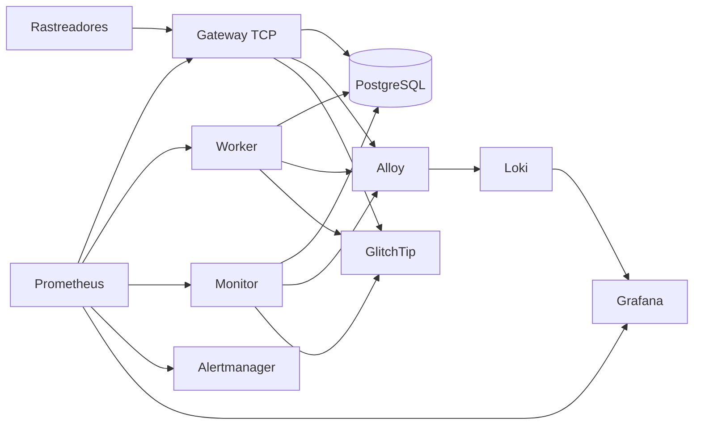

# Observabilidade

> **Status:** infraestrutura implementada e validada localmente. A validação local
> não certifica prontidão para produção.

Este documento descreve a infraestrutura que coleta e expõe sinais operacionais:
Actuator, Prometheus, Grafana, Loki, Alloy, Alertmanager e GlitchTip. O contrato
de métricas — nomes, tags, semântica, PromQL e dashboards — está em
[Métricas e painéis](metricas.md).

## Componentes e topologia

A aplicação usa Java 25, Spring Boot com Actuator, Micrometer, JDBC/HikariCP,
PostgreSQL 16/PostGIS e Flyway. A pilha de observabilidade é independente da
aplicação e se comunica pela rede externa `aporia-observability`.



| Componente | Papel |
| --- | --- |
| Gateway | Conexões TCP, identificação, ingestão de pacotes e despacho de comandos. O dispatcher fica na JVM proprietária das sessões. |
| Worker | Decodificação e processamento transacional dos pacotes, com heartbeat operacional. |
| Monitor | Coleta periódica de métricas agregadas das filas, usando uma role de banco somente leitura. Não consulta o banco a cada scrape. |
| API | Perfil reservado para a futura API REST de negócio. |
| Beszel | Monitoramento de hosts e containers já existente na infraestrutura externa; não faz parte deste projeto. |

## Infraestrutura Docker

Arquivos versionados:

- [compose.yaml](../compose.yaml): aplicação e bancos locais, por perfil Compose.
- [compose.observability.yaml](../compose.observability.yaml): Prometheus, Grafana,
  Alertmanager, Loki, Alloy, GlitchTip opcional e o proxy do Docker socket.
- `docker/observability`: configurações, regras e provisionamento dos painéis.

Aplicação e observabilidade são projetos Compose independentes. A rede
`aporia-observability` precisa existir antes de subir os containers.

## Portas padrão

| Serviço | Porta local |
| --- | ---: |
| Gateway TCP | 5500 |
| Gateway management | 9101 |
| Worker management | 9102 |
| Monitor management | 9104 |
| API futura | 8080 |
| API management futura | 9103 |
| PostgreSQL de desenvolvimento | 5437 |
| PostgreSQL de testes | 15437 |
| Prometheus | 9090 |
| Grafana | 3000 |
| Alertmanager | 9093 |
| GlitchTip | 8000 |
| Alloy | 12345 |

Os valores podem ser alterados pelas variáveis do `.env`. Não publique
interfaces administrativas diretamente na internet. No Compose, as portas de
management são publicadas em loopback.

## Inicialização

Crie a rede compartilhada uma única vez:

```sh
docker network inspect aporia-observability >/dev/null 2>&1 || \
  docker network create aporia-observability
```

Suba a infraestrutura e o banco de desenvolvimento:

```sh
docker compose -f compose.observability.yaml up -d --wait
docker compose --profile dev up -d --wait postgres
```

Aplique migrations e grants antes de iniciar os processos Java. O procedimento
completo, incluindo credenciais e recuperação, está em
[Deploy e operação](deploy.md).

```sh
docker compose --profile app up -d --wait
```

## Health checks

Os processos expõem:

- `/actuator/health`
- `/actuator/health/liveness`
- `/actuator/health/readiness`
- `/actuator/prometheus`
- `/actuator/info`

`liveness` representa a saúde do processo e não depende do banco. `readiness`
representa a disponibilidade operacional do componente e inclui as dependências
necessárias ao papel. Os grupos são definidos em `application-gateway.yml`,
`application-worker.yml` e `application-monitor.yml`.

`/actuator/prometheus` e `/actuator/info` exigem autenticação básica com a role
`MONITORING`. O usuário e a senha vêm de `TRACKING_MONITORING_USER` e
`TRACKING_MONITORING_PASSWORD`. As rotas de health são públicas para o
orquestrador; qualquer outra rota é negada.

## Métricas

A instrumentação usa Micrometer e exporta para Prometheus. O catálogo completo,
a cardinalidade permitida, a semântica pós-commit e as consultas PromQL estão em
[Métricas e painéis](metricas.md).

Resumo das famílias publicadas:

- Conexões TCP aceitas, encerradas, rejeitadas e ativas.
- Bytes recebidos, frames e pacotes por protocolo.
- Ingestão, falhas de persistência e latência de ingestão.
- Processamento, rejeição, retentativa e heartbeat do worker.
- Despacho, escrita TCP e recuperação de comandos.
- Profundidade e idade das filas de pacotes, comandos e outbox.
- Disponibilidade e idade do snapshot do monitor.
- Eventos de erro admitidos, suprimidos e descartados.
- JVM, GC, CPU, memória, HikariCP e pool JDBC.

## Logs

Os processos Java produzem logs estruturados em JSON (formato logstash). O Alloy
coleta os logs dos containers e os envia ao Loki; o Grafana consulta o Loki como
datasource.

O acesso ao Docker é feito por um socket proxy com operações de escrita
desabilitadas. Não registre credenciais, payloads brutos, tokens ou dados
pessoais. IDs operacionais podem aparecer em campos estruturados, mas não como
labels de alta cardinalidade.

## Rastreamento de exceções

O GlitchTip recebe eventos pelo SDK compatível com Sentry. A configuração
contempla:

- DSN externo (`TRACKING_SENTRY_DSN`).
- Ambiente e release.
- Identificação do componente (`gateway`, `worker` ou `monitor`).
- Filtragem de informações sensíveis.
- Deduplicação de eventos repetidos.
- Desabilitação de breadcrumbs e traces por padrão.

A indisponibilidade do banco foi usada para validar a captura de falhas do
worker e do monitor. Durante benchmarks, o envio pode ser desabilitado para não
poluir o histórico operacional.

## Alertas

As regras versionadas são carregadas pelo Prometheus e encaminhadas ao
Alertmanager. Os canais externos de notificação são configurados na implantação
e não devem guardar tokens ou credenciais no repositório.

Alertas iniciais cobrem target indisponível, fila envelhecida, crescimento de
erros, entrega incerta, saturação do pool JDBC, disco e amostragem
desatualizada. Ajuste os limites após medir a linha de base; ausência legítima de
tráfego não deve gerar alerta.

## Retenção

- Prometheus: 30 dias, limite de 5 GB.
- Loki: 14 dias.

A retenção da telemetria no PostgreSQL é uma política independente e deve ser
dimensionada com o volume real de posições, mensagens, eventos e índices.

## Segurança

- Interfaces administrativas privadas; publish apenas em loopback.
- Autenticação nas interfaces de monitoramento.
- Credenciais fora do Git, fornecidas pelo ambiente ou por segredos do deploy.
- Containers Java sem root, com filesystem somente leitura.
- Capabilities Linux removidas e `no-new-privileges`.
- Roles de banco segregadas por componente (`tracking_gateway`,
  `tracking_worker`, `tracking_monitor`).
- Migrations executadas administrativamente, nunca por um processo de runtime.
- Limites de CPU e memória por serviço.
- Rotação dos logs Docker.
- Socket do Docker exposto ao Alloy por proxy somente leitura.

## Limites padrão

| Componente | CPU | Memória |
| --- | ---: | ---: |
| Gateway | 1 vCPU | 512 MiB |
| Worker | 1 vCPU | 512 MiB |
| Monitor | 0,5 vCPU | 384 MiB |

Os valores são ajustáveis pelas variáveis do `.env`. Meça o consumo real antes de
dimensionar produção.

## Validação

```sh
mvn -Plint clean test
```

Os testes de integração usam exclusivamente o banco `aporia_tracking_test`, com
schema isolado por JVM. O simulador de carga usa o schema `tracking_load`; veja
[Simulador de carga](../src/test/load/README.md).

Validações realizadas:

- Testes unitários e de integração Java.
- Exposição e coleta de métricas.
- Dashboards provisionados e consultas PromQL.
- Logs centralizados no Loki.
- Captura e filtragem de exceções no GlitchTip.
- Recuperação após indisponibilidade do banco.
- Hardening de imagens e containers.
- Benchmarks de 10 e 100 dispositivos com reconciliação agregada.

## Riscos e evolução

Riscos residuais:

- Vulnerabilidades em imagens de terceiros.
- Permissões de leitura do Docker socket proxy.
- Segmentação da futura rede central.
- Teste integral de restauração de backups.
- Notificações externas do Alertmanager.
- Investigação do HTTP 422 em issues-stats do GlitchTip.
- Validação da exclusividade dos perfis Java.
- Homologação com equipamentos físicos.
- Determinação da capacidade máxima e da retenção ideal.

Evolução planejada:

- Métricas bidirecionais de tráfego TCP.
- Consumo por protocolo.
- Estatísticas de armazenamento.
- Benchmarks de maior capacidade.
- Cenários controlados de reconexão.
- API REST de negócio.

Toda evolução deve preservar o isolamento multi-tenant, os contratos
transacionais e as regras de [AGENTS.md](../AGENTS.md).

## Documentos relacionados

- [Índice da documentação](README.md)
- [Métricas e painéis](metricas.md)
- [Arquitetura e fluxos](arquitetura.md)
- [Deploy e operação](deploy.md)
- [Código do pacote de observabilidade](../src/main/java/software/aporia/tracking/observability)
